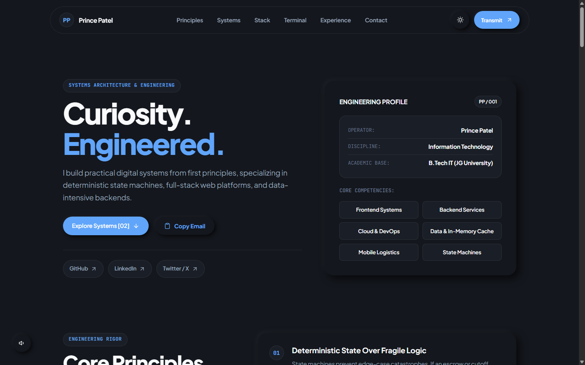

# Prince Patel — Systems Architect & Full-Stack Builder

A high-performance, minimalist personal portfolio engineered with a tactile neumorphic design system, deterministic state machines, interactive terminal emulator, and native dark/light mode switching.



## 🌐 Live Demo

- **GitHub Pages:** [https://prince312pp.github.io/Prince_Patel_267330_Portfolio/](https://prince312pp.github.io/Prince_Patel_267330_Portfolio/)
- **Repository:** [https://github.com/prince312pp/Prince_Patel_267330_Portfolio](https://github.com/prince312pp/Prince_Patel_267330_Portfolio)

---

## 🚀 Overview & Features

- **Tactile Neumorphism Design System:** Clean, soft-extrusion interface with high contrast ratios, strict 3-color palette (Surface + Grayscale + Sapphire Accent), and tactile button reactivity.
- **Dual Theme Switcher:** Fully responsive Dark Mode and Light Mode with real-time SVG icon state toggle and persistence via `localStorage`.
- **Interactive Terminal Console:** In-browser CLI emulator supporting commands like `help`, `bio`, `stack`, `projects`, `contact`, `clear`, and `theme`.
- **Live IST Clock & Telemetry:** Dynamic Indian Standard Time (UTC+05:30) system monitor and telemetry pill widgets.
- **Web Audio Haptics:** Synthesized procedural sine-wave click sounds for interactive tactile feedback without external audio asset bloat.
- **Project Showcases:** Deep dives into flagship systems (*Sponsorly* - escrow-backed creator marketplace, *TiffinMitra* - cutoff-driven logistics engine).
- **Responsive & Accessible:** Fluid CSS Grid / Flexbox architecture, ARIA attributes, semantic HTML5, and touch targets exceeding 44px.

---

## 🛠️ Technologies Used

- **HTML5:** Semantic markup, accessibility features, modern SEO metadata.
- **CSS3:** Custom properties (CSS variables), neumorphic box-shadow calculations, CSS Grid, Flexbox, smooth transitions.
- **JavaScript (ES6+):** Vanilla JavaScript for theme switching, Web Audio API procedural synthesis, terminal state management, clipboard API, and DOM manipulation (zero external runtime dependencies).
- **JSON:** Structured data schema (`portfolio_data.json`) decoupling content from presentation.
- **Google Fonts:** Plus Jakarta Sans & JetBrains Mono.

---

## 📁 Project Structure

```text
Prince_Patel_267330_Portfolio/
├── index.html            # Main markup and layout
├── style.css             # Neumorphic design system & responsive styling
├── script.js             # Terminal, theme engine & Web Audio synthesizer
├── portfolio_data.json   # Structured profile, projects, and skills data
├── screenshot.png        # Portfolio interface preview (Dark Mode)
└── README.md             # Project documentation & live links
```

---

## 💻 Local Setup & Development

1. **Clone the repository:**
   ```bash
   git clone https://github.com/prince312pp/Prince_Patel_267330_Portfolio.git
   cd Prince_Patel_267330_Portfolio
   ```

2. **Run locally:**
   Since this is a lightweight static portfolio with zero build dependencies, you can open `index.html` directly in any modern browser, or serve it using any local static file server:
   ```bash
   # Using Python
   python -m http.server 8000

   # Or using Node npx
   npx serve .
   ```

3. **Visit in browser:**
   Navigate to `http://localhost:8000`

---

## 👤 Author

- **Name:** Prince Patel
- **Roll Number:** 267330
- **GitHub:** [@prince312pp](https://github.com/prince312pp)
- **LinkedIn:** [Prince Patel](https://www.linkedin.com/in/prince-patel-b102492b1/)
- **Email:** prince.patel3628@gmail.com

---

## 📄 License

This project is open-source and available under the [MIT License](LICENSE).
